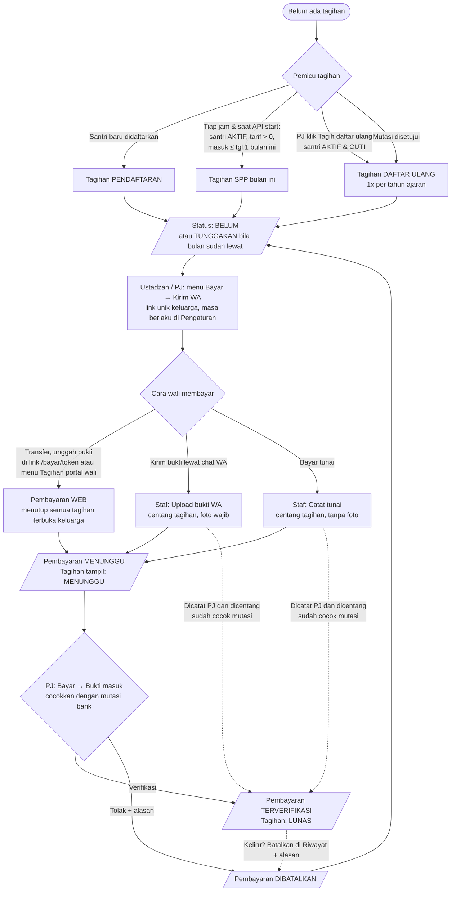
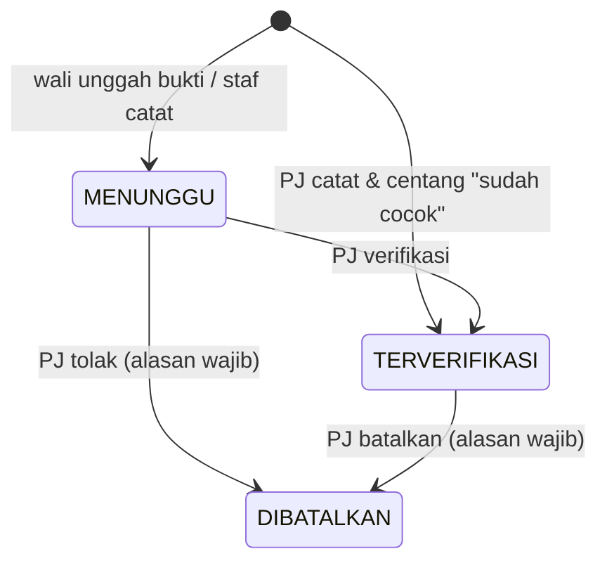

# Alur SPP & Bayar — versi ringkas

Peta sederhana dari **belum ada tagihan → tagihan dibuat → dibayar → diverifikasi**. Detail endpoint ada di `API.md`, cara pakai per role di `PANDUAN.md`. Kode: `apps/api/src/modules/billing/billing.module.ts`.

Nilai yang bisa diubah PJ di **menu Pengaturan**: tarif SPP & pendaftaran per cabang, biaya daftar ulang, bulan mulai tahun ajaran, rekening yayasan, masa berlaku link wali, template pesan WA. Tagihan yang sudah terbit tidak ikut berubah.

## Inti dalam 4 kalimat

1. **Tagihan** (`invoices`) dibuat oleh sistem, bukan diketik manual per santri.
2. **Pembayaran** (`payments`) dicatat dengan bukti, lalu ditautkan ke satu atau beberapa tagihan (`payment_allocations`).
3. **Hanya PJ RTA** (`bayar.setujui`) yang bisa memverifikasi; semua entri lain berstatus **MENUNGGU**.
4. **Status tagihan tidak disimpan**: dihitung ulang setiap kali dibaca dari pembayaran yang tertaut.

## Diagram alur

## Siapa membuat tagihan apa

| Jenis | Kapan dibuat | Siapa/apa yang memicu | Nominal |
|---|---|---|---|
| **PENDAFTARAN** | Saat santri baru disimpan | Otomatis (StudentsService) | Biaya pendaftaran cabang (Pengaturan) |
| **SPP** | Bulan berjalan, dicek tiap jam & saat API start | Otomatis (penjadwal); bisa dipicu manual lewat `POST /spp/generate` (`spp.input`) | `spp_rate` santri: tarif standar cabang, tarif kategori subsidi (Pengaturan → Tarif subsidi), atau tarif khusus manual |
| **DAFTAR ULANG** | Awal tahun ajaran (mulai Juli) | PJ klik **Tagih daftar ulang** di menu SPP | Biaya daftar ulang (Pengaturan, bawaan Rp100.000) |
| **DAFTAR ULANG** (biaya pindah) | Saat mutasi disetujui | Otomatis (Pengajuan) | Sama dengan biaya daftar ulang |

- Tidak pernah dobel: indeks unik `(santri, jenis, periode)` → menjalankan ulang aman.
- **Tidak ditagih SPP**: santri CUTI, Indent, KELUAR, tarif Rp0, atau masuk setelah tanggal 1.
- Daftar ulang dan biaya pindah maksimal satu kali per tahun ajaran, juga bila bulan mulai tahun ajaran digeser (cek ±6 bulan).

## Status tagihan (dihitung, bukan disimpan)

Dicek berurutan, yang pertama cocok dipakai:

| Urutan | Syarat | Status |
|---|---|---|
| 1 | Total pembayaran **terverifikasi** ≥ nominal | **LUNAS** |
| 2 | Terverifikasi + **menunggu** ≥ nominal | **MENUNGGU** |
| 3 | Cicilan pendaftaran: lewat tanggal jatuh tempo · tagihan lain: periode sebelum bulan ini | **TUNGGAKAN** |
| 4 | Cicilan pendaftaran yang jatuh temponya bulan depan atau setelahnya (belum ditagihkan, bisa dilunasi lebih awal) | **TERJADWAL** |
| 5 | Selain itu | **BELUM** |

Pembayaran yang **DIBATALKAN** tidak dihitung, jadi tagihannya otomatis kembali ke BELUM/TUNGGAKAN.

## Status pembayaran

Tidak ada pembayaran yang dihapus; semua perubahan masuk audit log.

## Aturan yang perlu diingat

- **Nominal = total tagihan yang dicentang.** Bayar sebagian belum didukung (Fase 4).
- **Transfer wajib bukti** (JPG/PNG/WebP/PDF, maks. 5 MB). Tunai tidak perlu foto.
- **Unggahan wali** otomatis menutup *semua* tagihan BELUM/TUNGGAKAN keluarga itu sekaligus.
- **Link wali**: satu link aktif per keluarga; membuat link baru mencabut yang lama. Pesan WA memakai template di Pengaturan.
- **Ustadzah** hanya melihat & mencatat untuk cabangnya; verifikasi tetap di PJ.
- **Menguji tanggal 1** tanpa menunggu, dari terminal (lokal): `bun run test:bill` = pratinjau tanggal 1 bulan depan (siapa ditagih, siapa tidak & alasannya, total per cabang; tidak ada yang disimpan). `bun run test:bill 2026-12 --detail` untuk bulan tertentu + daftar santri; tambah `--simpan` agar tagihan benar-benar dibuat. Ditolak di produksi / database non-lokal.
- Atau dari aplikasi: menu SPP → pilih bulan depan → *Buat tagihan SPP* (PJ), atau `POST /spp/generate?month=YYYY-MM`. Yang ditagih: santri Aktif dengan tanggal bergabung ≤ tgl 1 bulan itu; Cuti/Indent/Keluar tidak. Uji otomatisnya ada di `test/e2e.ts` bagian *SPP bulanan (simulasi tanggal 1)*.
- **Label subsidi** tidak pernah tampil ke wali, Manajer, maupun pesan WA.
- Sebelum memverifikasi, **selalu cocokkan dengan mutasi rekening** yayasan. Jangan bagikan tangkapan layar bukti/daftar tagihan ke grup terbuka.
