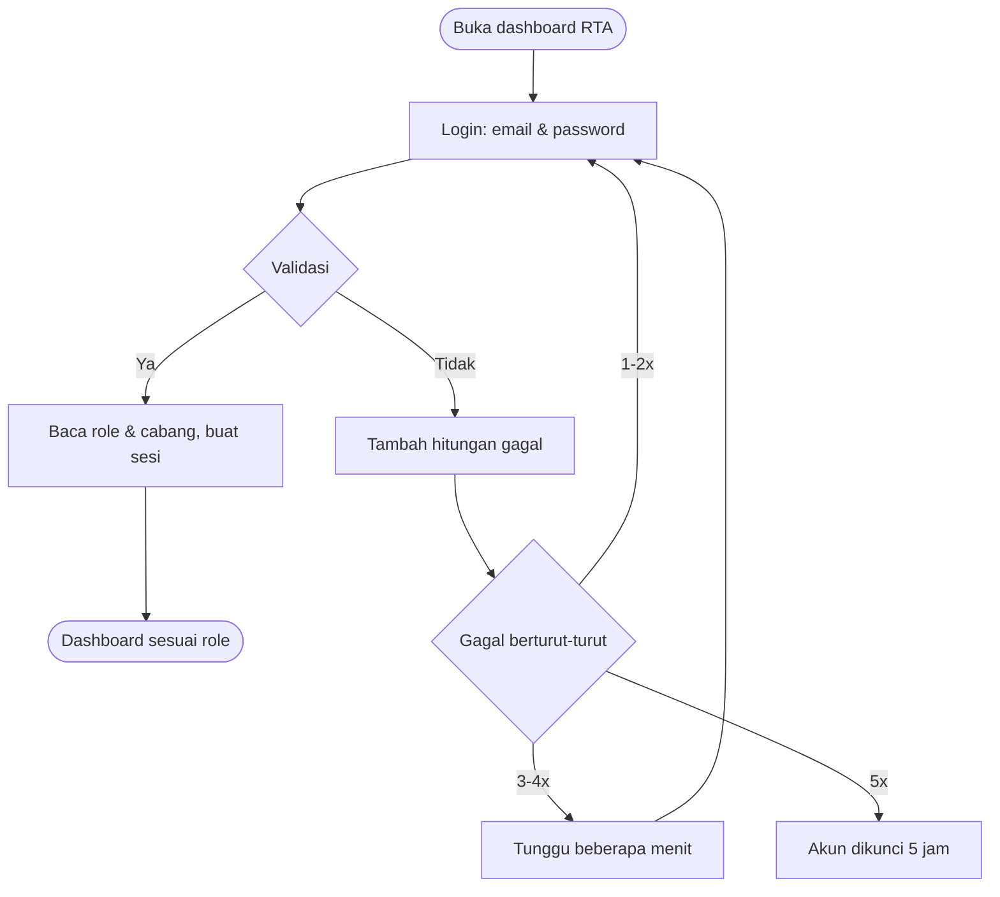
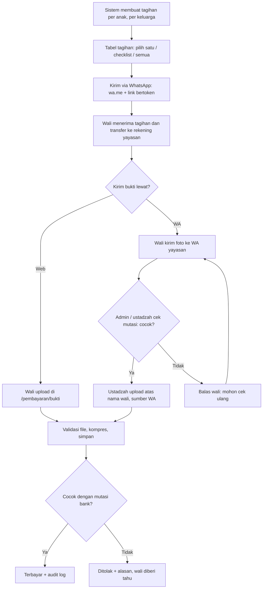
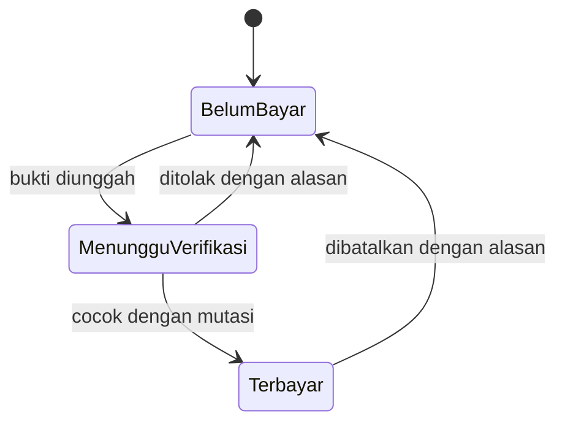

# PRD — Dashboard Manajemen Rumah Tahfidz Al-Fatihah (RTA)

| | |
|---|---|
| **Versi** | 0.1 (draft untuk review PJ RTA) |
| **Tanggal** | 27 Oktober 2026 |
| **Sumber** | Brief awal, Dokumen Kebutuhan Sistem RTA, alur menu & diagram flow terbaru dari tim |
| **Pendamping** | `design.md` (sistem desain), `RTA_Diagram_Alur_Aplikasi.drawio` (15 halaman diagram, bisa diedit di app.diagrams.net) |

**Cara membaca dokumen ini.** Alur menu terbaru dari tim menjadi acuan utama. Bila ada beda dengan dokumen kebutuhan sebelumnya, alur terbaru yang dipakai dan bedanya dicatat di [bagian 14](#14-asumsi-konflik-dan-pertanyaan-terbuka). Tanda **[Usulan]** berarti belum disepakati PJ RTA. Tanda **[Konfirmasi]** berarti ada pertanyaan yang harus dijawab sebelum fitur dibangun.

---

## 1. Ringkasan

Dashboard berbasis web untuk mengelola data santri, pembayaran SPP, capaian hafalan, dan laporan perkembangan santri (LPS) di 4 cabang RTA (Genuk, Supriyadi, Pedurungan, Ngaliyan) dalam satu sistem terpusat.

- **Pengguna sistem** adalah staf: Admin Sistem, PJ RTA, Ustadzah, dan Manajer/Pimpinan. Akses dibatasi per role dan per cabang.
- **Wali santri tidak punya akun.** Mereka menerima tagihan lewat WhatsApp dan mengunggah bukti transfer lewat halaman publik bertoken (`/pembayaran/bukti`), atau mengirim bukti lewat WhatsApp yang lalu diunggah oleh ustadzah.
- **Pembayaran memakai transfer langsung ke rekening yayasan**, tanpa payment gateway, sehingga tidak ada potongan pihak ketiga. Pencocokan dilakukan dengan memeriksa mutasi bank.

## 2. Tujuan dan indikator keberhasilan

| # | Tujuan | Indikator (target usulan) |
|---|---|---|
| 1 | Ustadzah tidak lagi mencatat manual berulang | Santri baru terdaftar kurang dari 3 menit; impor data awal menggantikan input ulang |
| 2 | PJ memantau seluruh cabang secara terpusat | Rekap jumlah santri dan tunggakan tersedia di dashboard tanpa input manual |
| 3 | Angka akurat dan konsisten | Semua angka dashboard dihitung dari data modul; angka keuangan dicocokkan dengan mutasi bank sebelum dipublikasi |
| 4 | Setiap perubahan dapat ditelusuri | 100% perubahan data santri, keluarga, status, subsidi, pembayaran, dan hafalan masuk audit log |
| 5 | Data anak aman | 0 akses lintas cabang (diuji otomatis di UI, API, dan ekspor) |
| 6 | Penagihan lebih ringan | Mayoritas bukti diverifikasi dalam 1×24 jam kerja |

## 3. Ruang lingkup

**Termasuk:** login dan keamanan akun, manajemen akun dan role, manajemen santri/ustadzah/wali, status santri dan pengajuan, kelas dan capaian hafalan, SPP (tagihan otomatis, pencatatan pembayaran, kirim tagihan via WhatsApp, upload bukti, verifikasi), LPS, dashboard, impor/ekspor data, audit log, backup.

**Tidak termasuk (saat ini):**
- Portal wali dengan login (ditunda; lihat bagian 14).
- Payment gateway (QRIS/VA) dan integrasi otomatis cek mutasi.
- Pengiriman WhatsApp otomatis (Fase 4, via CekatAI).
- Pencatatan santri trial.
- Pengumpulan NIK atau data identitas negara (prinsip minimalisasi data), kecuali yayasan membutuhkannya untuk pelaporan resmi.

## 4. Pengguna dan hak akses

### 4.1 Role

| Role | Cakupan data | Ringkasan kewenangan |
|---|---|---|
| **Admin Sistem** | Teknis | Full: Dashboard, Akun, Role. Baca tabel saja + backup: SPP, LPS, Kelas, Manajemen Santri, Manajemen Ustadzah |
| **PJ RTA** | Semua cabang | Full akses. Menyetujui keluar dan mutasi, memasang subsidi, mengatur tarif dan akses |
| **Ustadzah** | Cabang yang ditugaskan | Dashboard; SPP (input pembayaran); LPS (baca tabel saja); Kelas (input hafalan + baca tabel); Manajemen Santri (input, baca, edit) |
| **Manajer / Pimpinan** | Semua cabang, hanya lihat | Akses semua menu operasional, hanya lihat dan ekspor |

### 4.2 Matriks akses per menu

Sel bertanda `*` adalah **asumsi** saya karena belum tertulis di alur tim.

| Menu | Admin Sistem | PJ RTA | Ustadzah (cabangnya) | Manajer |
|---|---|---|---|---|
| Dashboard | Full | Full | Lihat + ekspor | Lihat semua + ekspor |
| SPP / Pembayaran | Baca tabel | Full | Input pembayaran, verifikasi\*, kirim WA | Lihat + ekspor |
| LPS | Baca tabel | Full | Baca tabel saja | Lihat + ekspor |
| Kelas + Hafalan | Baca tabel | Full | Input hafalan + baca tabel | Lihat + ekspor |
| Manajemen Santri | Baca tabel | Full | Input, baca, edit; catat cuti; ajukan keluar/mutasi\* | Lihat + ekspor |
| Manajemen Ustadzah | Baca tabel | Full | — | Lihat + ekspor |
| Manajemen Wali | Baca tabel\* | Full | Input & baca lewat form santri\* | Lihat + ekspor |
| Persetujuan keluar/mutasi\* | — | Setujui / tolak | Ajukan | Lihat |
| Role | Full | Full | — | —\* |
| Akun | Full | Full | — | —\* |
| Backup & konfigurasi | Full | — | — | — |
| Impor data | — | Full | Sesuai menu yang boleh diinput\* | — |
| Ekspor PDF | —\* | Full | Cabangnya, field sensitif dimasking | Semua, field sensitif dimasking |

### 4.3 Aturan akses (wajib)

1. **Scope cabang ditegakkan di server**, bukan hanya dengan menyembunyikan menu. Setiap query difilter berdasarkan cabang penugasan pengguna.
2. Ustadzah tidak dapat melihat data cabang lain, termasuk lewat pencarian, ekspor, dan tautan langsung.
3. Satu ustadzah dapat ditugaskan ke lebih dari satu cabang. Penugasan sementara (ustadzah pengganti) punya tanggal mulai dan berakhir, lalu tertutup otomatis.
4. **Field sensitif** (alamat, no. WA utama, HP cadangan, pekerjaan orang tua, subsidi + dokumennya, catatan kesehatan, foto) hanya terlihat PJ dan ustadzah cabang terkait, termasuk di hasil ekspor.
5. Label subsidi "yatim" dan "kurang mampu" disembunyikan dari Manajer; yang tampil hanya nominal.
6. Satu akun per orang, tidak boleh dipakai bersama. Akun ustadzah yang tidak lagi bertugas dinonaktifkan oleh PJ RTA.
7. Role Admin Sistem dan PJ RTA tidak dapat dihapus; PJ tidak dapat mencabut aksesnya sendiri.

## 5. Peta menu dan pola halaman

**Sidebar:** Dashboard · SPP · LPS · Kelas · Manajemen Pengguna (Santri, Ustadzah, Wali) · Role · Akun.

Menu **SPP**, **LPS**, **Kelas**, **Manajemen Santri**, **Manajemen Ustadzah**, dan **Manajemen Wali** memakai **pola halaman yang sama**, sesuai diagram flow tim:

```
Buka menu → cek hak akses & scope → ambil data dari server → Fitur:
 ├─ Input data  → formulir → validasi → (gagal: alert kesalahan | berhasil: simpan + tampil di tabel)
 ├─ Ekspor      → buat PDF sesuai scope & masking → catat log ekspor → selesai
 ├─ Impor data  → upload file → validasi file → (gagal: alert error | berhasil: simpan + tampil di tabel)
 └─ Table data  → ambil dari database ⇄ tampilkan
```

Konsekuensi: satu komponen halaman generik (tabel + formulir + dialog impor + dialog ekspor) bisa dipakai ulang di 6 menu. Ini memangkas pekerjaan frontend secara signifikan.

## 6. Kebutuhan fungsional

Prioritas: **P0** wajib untuk rilis fase terkait, **P1** penting, **P2** nilai tambah.

### 6.1 Autentikasi dan keamanan akun

| ID | Kebutuhan | Prio |
|---|---|---|
| AUTH-1 | Login dengan email dan password. Pesan error selalu umum (tidak menyebut mana yang salah) | P0 |
| AUTH-2 | Setelah login valid, sistem membaca role dan cabang, lalu menampilkan menu sesuai hak akses | P0 |
| AUTH-3 | **Gagal 3x berturut-turut: tunggu beberapa menit** sebelum boleh mencoba lagi (default 5 menit, bisa diatur) | P0 |
| AUTH-4 | **Gagal 5x berturut-turut: akun dikunci sementara selama 5 jam.** Admin Sistem/PJ dapat membuka kunci **[Usulan]** | P0 |
| AUTH-5 | Hitungan gagal direset setelah login berhasil. Pembatasan juga diterapkan per alamat IP agar akun tidak bisa dikunci massal oleh pihak luar | P0 |
| AUTH-6 | Password disimpan sebagai hash (argon2). Login pertama wajib ganti password **[Usulan]** | P0 |
| AUTH-7 | Sesi: access token singkat + refresh token di cookie httpOnly dengan rotasi; logout mencabut sesi | P0 |
| AUTH-8 | 2FA untuk PJ RTA dan Admin Sistem **[Usulan]** | P2 |



### 6.2 Dashboard

Semua angka dihitung otomatis di server. Tidak ada angka yang diinput manual.

| ID | Kebutuhan | Prio |
|---|---|---|
| DSH-1 | Kartu: **Total santri**, **Total ustadzah** | P0 |
| DSH-2 | Status santri: **Indent, Aktif, Cuti, Keluar**. Aktif sudah termasuk santri yang pengajuan keluar/mutasinya menunggu persetujuan. Keluar dihitung pada periode terpilih | P0 |
| DSH-3 | Keuangan: **Total tagihan, Terbayar, Belum terbayar, Tunggakan** (filter cabang dan bulan) | P0 (Fase 2) |
| DSH-4 | Hafalan: **rata-rata capaian per kelas** (hanya santri Aktif) | P0 (Fase 2) |
| DSH-5 | Kartu **Perlu tindakan** untuk PJ: pengajuan keluar/mutasi yang menunggu, bukti pembayaran yang menunggu verifikasi | P1 |
| DSH-6 | Filter cabang dan bulan untuk PJ dan Manajer. Untuk Ustadzah, cabang terkunci | P0 |
| DSH-7 | Ekspor PDF sesuai scope dan masking; catat log ekspor | P0 |

Definisi tambahan **[Konfirmasi]**: "Total ustadzah" = ustadzah dengan akun aktif dan penugasan cabang aktif.

### 6.3 Manajemen Santri

| ID | Kebutuhan | Prio |
|---|---|---|
| STD-1 | Tambah santri lewat formulir bertahap: (1) keluarga, (2) identitas, (3) cabang & kelas, (4) status awal | P0 |
| STD-2 | ID santri dibuat otomatis: **`RTA-<kode cabang pendaftaran>-<urut per cabang>`**, mis. `RTA-GNK-001` (GNK Genuk, SPY Supriyadi, PDR Pedurungan, NGL Ngaliyan). **Tidak berubah saat mutasi** | P0 |
| STD-3 | Cek no. WA wali saat mengisi keluarga: bila sudah terdaftar, pilih keluarga yang ada agar tidak duplikat. Bila terdaftar di cabang lain, tampilkan peringatan tanpa membuka detail dan tandai untuk PJ | P0 |
| STD-4 | Deteksi duplikat santri (nama + tanggal lahir) sebelum simpan | P1 |
| STD-5 | Pilihan cabang dan kelas hanya jenjang yang tersedia di cabang tersebut | P0 |
| STD-6 | Edit data santri dan keluarga; setiap perubahan mencatat nilai lama dan baru | P0 |
| STD-7 | Tabel dengan pencarian, filter (cabang, kelas, status), urut, dan halaman dari server | P0 |
| STD-8 | Impor data awal dari template xlsx/csv; ekspor PDF | P0 |
| STD-9 | Data tidak pernah dihapus permanen; santri keluar diarsipkan dan tetap bisa dicari | P0 |

**Identitas santri:** nomor induk (otomatis), nama lengkap, nama panggilan, jenis kelamin, tempat dan tanggal lahir (usia otomatis), sekolah formal dan kelas, keluarga, cabang dan kelas, tanggal masuk, status, subsidi + dokumen (dipasang PJ), catatan kesehatan/alergi, foto.

### 6.4 Status santri dan pengajuan

Status utama ada empat: **Indent** (terdaftar, belum mulai belajar) · **Aktif** · **Cuti** · **Keluar** (arsip). Pengajuan keluar dan mutasi **tidak dimodelkan sebagai status**, melainkan sebagai entitas `pengajuan` dengan state menunggu / disetujui / ditolak. Dengan begitu hitungan Aktif tidak punya pengecualian.

| ID | Kebutuhan | Prio |
|---|---|---|
| STS-1 | **Cuti** dicatat langsung oleh ustadzah: tanggal mulai dan alasan wajib; saat kembali aktif, tanggal kembali dicatat | P0 |
| STS-2 | **Keluar** diajukan ustadzah (tanggal efektif, alasan); PJ menyetujui atau menolak dengan catatan | P0 |
| STS-3 | **Mutasi** diajukan ustadzah (cabang dan kelas tujuan); setelah disetujui, riwayat hafalan dan keuangan ikut pindah dan ustadzah cabang asal tidak lagi melihat santri tersebut | P0 |
| STS-4 | Selama menunggu persetujuan, santri tetap dihitung Aktif di cabang asal. Hanya satu pengajuan aktif per santri | P0 |
| STS-5 | Kenaikan jenjang dalam cabang yang sama: diajukan ustadzah, disetujui PJ **[Usulan]** | P1 |
| STS-6 | Setiap perubahan status mencatat tanggal, alasan, dan nama pencatat sebagai riwayat. Alasan diambil dari master alasan agar bisa direkap | P0 |
| STS-7 | Riwayat penempatan cabang/kelas disimpan sebagai tabel riwayat dengan tanggal efektif | P0 |
| STS-8 | Santri Genuk yang lanjut ke Juz 29 wajib lewat mutasi (Genuk hanya punya Juz 30) | P0 |

Transisi yang perlu diputuskan **[Konfirmasi]**: Cuti → pengajuan keluar/mutasi, Indent → Keluar (batal sebelum mulai), Keluar → Aktif (kembali mendaftar), penarikan pengajuan oleh ustadzah.

### 6.5 Manajemen Wali (keluarga)

| ID | Kebutuhan | Prio |
|---|---|---|
| WLI-1 | Data wali disimpan **sekali per keluarga**, dihubungkan ke satu atau lebih santri | P0 |
| WLI-2 | Field: nama ayah, nama ibu, nama wali + hubungan (bila diasuh selain orang tua), no. WA utama, HP cadangan, alamat, pekerjaan | P0 |
| WLI-3 | Perubahan no. WA cukup sekali dan berlaku untuk semua anak | P0 |
| WLI-4 | Wali tidak punya akun login | P0 |
| WLI-5 | PJ dapat menautkan keluarga yang sama di lintas cabang | P1 |

### 6.6 Manajemen Ustadzah

| ID | Kebutuhan | Prio |
|---|---|---|
| UST-1 | Profil ustadzah: nama, kontak, cabang tugas (bisa lebih dari satu), masa tugas | P0 |
| UST-2 | Ustadzah pengganti dengan tanggal mulai dan berakhir; akses menutup otomatis | P0 |
| UST-3 | Nonaktifkan ustadzah tanpa menghapus data dan riwayat input | P0 |
| UST-4 | Akun login dibuat di menu Akun | P0 |

### 6.7 Kelas dan capaian hafalan

Kelas adalah kombinasi **cabang × jenjang**. Menu Kelas menampung data penempatan santri dan input hafalan.

| ID | Kebutuhan | Prio |
|---|---|---|
| KLS-1 | Penempatan santri ke kelas; santri hanya bisa ditempatkan di jenjang yang tersedia di cabangnya | P0 |
| HFL-1 | Ustadzah mencatat posisi hafalan terakhir tiap santri **sekali sepekan**: pilih surah lalu ayat terakhir dari daftar referensi | P0 (Fase 2) |
| HFL-2 | Daftar surah hanya surah dari jenjang santri tersebut | P0 |
| HFL-3 | Tolak ayat di luar jumlah ayat surah. Beri peringatan bila posisi baru lebih rendah dari sebelumnya (boleh dikonfirmasi) | P0 |
| HFL-4 | Setiap input tersimpan sebagai riwayat (tanggal, jenjang, pencatat). Input ulang di pekan yang sama menggantikan yang lama tetapi tetap ada di riwayat **[Usulan]** | P0 |
| HFL-5 | Sistem menghitung jumlah ayat dan persentase otomatis (rumus di bagian 8.5) | P0 |
| HFL-6 | Tampilan: kartu santri (posisi, ayat, persen, grafik per pekan) dan rekap per kelas/cabang (rata-rata dan posisi terjauh) | P1 |
| HFL-7 | Penanda santri yang tidak bertambah selama 2 pekan berturut-turut, dengan pengecualian cuti dan libur **[Usulan]** | P2 |

### 6.8 SPP, tagihan, dan pembayaran

**Tiga jenis tagihan dibuat otomatis oleh sistem:** pendaftaran (saat santri didaftarkan), daftar ulang (awal tahun pembelajaran), SPP (tanggal 1 setiap bulan). Ustadzah **tidak menginput tagihan**; ia mencatat pembayaran, memverifikasi, dan mengirim tagihan.

| ID | Kebutuhan | Prio |
|---|---|---|
| SPP-1 | Tagihan dibuat per anak, **dikelompokkan per keluarga**, dan ditampilkan dalam tabel | P0 |
| SPP-2 | Tarif disimpan ke data santri saat didaftarkan (snapshot); kenaikan tarif tidak mengubah santri lama. Santri mutasi mengikuti tarif cabang tujuan mulai bulan efektif | P0 |
| SPP-3 | Tagihan **tidak diedit**; koreksi lewat penyesuaian atau pembatalan dengan alasan | P0 |
| SPP-4 | Tombol **Kirim via WhatsApp** pada tabel tagihan: satu-satu, checklist beberapa, atau semua. Membuka `wa.me` dengan nomor wali dan isi pesan berisi link bertoken | P0 |
| SPP-5 | Untuk pengiriman banyak keluarga, sistem menyajikan **antrean "kirim berikutnya"** (WhatsApp tidak mengizinkan kirim massal otomatis dari browser). Pengiriman dicatat (siapa, kapan, keluarga) | P0 |
| SPP-6 | **Halaman publik `/pembayaran/bukti`** untuk wali (lihat 6.8.1) | P0 |
| SPP-7 | Jalur WhatsApp: wali kirim bukti ke nomor WA yayasan; admin/ustadzah cek mutasi dan mencocokkan; bila cocok, ustadzah mengunggah atas nama wali (sumber tercatat "WA") | P0 |
| SPP-8 | Bukti yang diunggah dikompres, disimpan di storage privat, dan jalurnya dicatat di database | P0 |
| SPP-9 | Verifikasi: admin/ustadzah/PJ mencocokkan bukti dengan mutasi bank, lalu menandai Terbayar atau menolak dengan alasan wajib | P0 |
| SPP-10 | Pembayaran tercatat **tidak bisa diedit atau dihapus**. Koreksi: batalkan entri (alasan wajib), lalu catat entri baru | P0 |
| SPP-11 | Status tagihan: **Belum bayar → Menunggu verifikasi → Terbayar**. Tagihan bulan sebelumnya yang belum lunas tampil sebagai **Tunggakan** | P0 |
| SPP-12 | Tanggal 10 adalah **tanggal pengingat, bukan batas bayar**: tampilkan daftar keluarga berstatus Belum bayar dan Tunggakan, satu baris per keluarga | P1 |
| SPP-13 | Impor SPP untuk data awal (saldo tunggakan, riwayat pembayaran) | P1 |
| SPP-14 | Rekap pembayaran per santri, cabang, dan periode; ekspor PDF | P0 |
| SPP-15 | Angka keuangan di laporan dicocokkan dengan mutasi bank sebelum dipublikasikan. Tutup periode bulanan **[Usulan]** | P1 |





#### 6.8.1 Halaman publik bukti pembayaran

Wali tidak login. Akses lewat link bertoken yang dikirim melalui WhatsApp.

- **Token:** acak, panjang (minimal 128 bit), hanya hash yang disimpan; punya masa berlaku (default 30 hari **[Usulan]**); satu tautan per keluarga. Mengirim ulang membuat link baru dan mencabut yang lama **[Usulan]**.
- **Isi halaman:** nama panggilan anak, periode, nominal per tagihan dan total, informasi rekening yayasan, dan tombol unggah bukti. **Tidak** menampilkan alamat, no. WA, atau kategori subsidi.
- **Upload:** hanya JPG/PNG/WebP/PDF; ukuran dibatasi; jenis file diperiksa dari isi file (bukan hanya ekstensi); gambar dikompres di browser lalu dinormalkan ulang di server (metadata EXIF dibuang); dibatasi laju per token dan per IP.
- **Sesudah unggah:** tampil konfirmasi "Bukti diterima, sedang kami periksa". Status tagihan menjadi Menunggu verifikasi dan muncul di kartu "Perlu tindakan".
- **Kasus:** bukti ganda (nominal, tanggal, keluarga sama) memunculkan peringatan; satu bukti dapat dikaitkan ke beberapa tagihan.
- Opsi pengamanan tambahan bila diperlukan: OTP via WhatsApp sebelum halaman terbuka **[Konfirmasi]**.

**Template pesan WhatsApp** (nada hangat, singkat, tidak menyebut kategori subsidi):

```
Assalamu'alaikum Bapak/Ibu 🌿
Tagihan SPP {bulan} untuk {nama_panggilan} sudah tersedia: Rp{total}.
Rincian dan unggah bukti transfer: {link}
Jazakumullahu khairan 🤍
```

### 6.9 LPS (Laporan Perkembangan Santri)

Dibangun di **Fase 3** karena format penilaian dan alur persetujuan belum final.

| ID | Kebutuhan | Prio |
|---|---|---|
| LPS-1 | Menu LPS dengan pola halaman standar (input, ekspor, impor, tabel) | P0 (Fase 3) |
| LPS-2 | Data hafalan ditarik otomatis dari modul Kelas; yang diisi hanya aspek lain (BTQ, tahsin, adab, doa harian, catatan) | P0 |
| LPS-3 | Komponen penilaian disimpan sebagai master data agar format bisa diubah tanpa mengubah kode | P1 |
| LPS-4 | Hasil akhir berupa PDF yang bisa diunduh, dicetak, dan dikirim ke wali via WhatsApp | P0 |
| LPS-5 | Alur penerbitan: Draft → Diperiksa → Disetujui PJ → Terbit **[Usulan]** | P1 |

**[Konfirmasi]** Di alur tim, Ustadzah hanya *membaca* tabel LPS. Siapa yang menginput LPS: PJ RTA atau ustadzah? Lihat bagian 14.

### 6.10 Role

| ID | Kebutuhan | Prio |
|---|---|---|
| ROL-1 | Buka menu Role → tampil daftar role → edit akses → **daftar akses yang bisa di-checklist** per menu (lihat, input, edit, ekspor, impor) | P0 |
| ROL-2 | Perubahan permission kritis meminta konfirmasi dan dicatat di audit log (siapa, kapan, nilai lama → baru) **[Usulan]** | P1 |
| ROL-3 | Perubahan berlaku saat login atau refresh token berikutnya | P0 |
| ROL-4 | Permission selalu dibatasi lagi oleh scope cabang di server | P0 |

### 6.11 Akun

| ID | Kebutuhan | Prio |
|---|---|---|
| ACC-1 | Register akun: nama, email, password, role (ustadzah: pilih cabang tugas) | P0 |
| ACC-2 | Validasi: email unik, password memenuhi aturan kekuatan minimal | P0 |
| ACC-3 | Tabel data akun dan daftar role; aksi nonaktifkan, reset password, buka kunci login | P0 |
| ACC-4 | Hanya Admin Sistem dan PJ RTA yang mengakses menu ini | P0 |

### 6.12 Impor, ekspor, dan audit

| ID | Kebutuhan | Prio |
|---|---|---|
| IMP-1 | Unduh template; unggah xlsx/csv; sistem memvalidasi **seluruh file** dan menampilkan daftar baris bermasalah. Bila ada error, tidak ada data yang disimpan (all-or-nothing per file) | P0 |
| IMP-2 | Impor hanya boleh memuat data dalam scope cabang pengguna | P0 |
| IMP-3 | Pemetaan data awal: nama cabang lama "Pedurungan 1/2" dipetakan ke Supriyadi/Pedurungan; ejaan nama, kelas, dan status dibersihkan; hasil diverifikasi PJ sebelum sistem dipakai | P0 |
| EXP-1 | Ekspor PDF mengikuti scope pengguna dan menyembunyikan field sensitif untuk role yang tidak berhak. Excel (xlsx) untuk olah data **[Usulan]** | P0 |
| EXP-2 | Setiap ekspor dan cetak mencatat pengguna, waktu, jenis laporan, dan filter | P0 |
| AUD-1 | Audit log untuk data santri, keluarga, status, subsidi, pembayaran, hafalan, role, akun, dan impor: siapa, kapan, nilai lama, nilai baru | P0 |
| AUD-2 | Audit log hanya bisa dibaca oleh PJ dan Admin Sistem **[Usulan]**; tidak bisa diubah atau dihapus lewat aplikasi | P0 |

**Laporan yang tersedia:** rekap santri per cabang (per status dan kelas), rekap keuangan bulanan (per jenis tagihan dan cabang, daftar tunggakan), rekap hafalan (posisi dan persen per santri, rata-rata per kelas), daftar pengingat tanggal 10, dan Weekly Report (otomatis di Fase 4).

## 7. Alur pengguna utama

Diagram lengkap ada di `RTA_Diagram_Alur_Aplikasi.drawio`:

| Halaman | Isi |
|---|---|
| 1. Arsitektur | Komponen sistem dan aliran data |
| 2. Login & Role | Login, penghitungan gagal login, 4 role dan akses masing-masing |
| 3. Peta Akses | Matriks menu × role |
| 4. Dashboard | Hitung otomatis, filter, ekspor |
| 5–8, 10, 12, 13 | Pola standar untuk SPP, LPS, Kelas, Manajemen Santri, Manajemen Ustadzah, Manajemen Wali |
| 6. Tagihan & Pembayaran | Kirim via WhatsApp, bukti lewat WEB atau WA, verifikasi |
| 9. Input Hafalan | Input pekanan, validasi, perhitungan |
| 11. Status Santri | Cuti, keluar, mutasi, persetujuan PJ |
| 14. Role, 15. Akun | Edit akses dengan checklist; register akun |

## 8. Aturan bisnis

Aturan ini berasal dari Dokumen Kebutuhan Sistem yang sudah disepakati PJ RTA, kecuali yang bertanda **[Usulan]**.

### 8.1 Cabang, kelas, dan tarif dasar

| Cabang | Juz 30 | Juz 29 | Juz 28 | SPP standar | Pendaftaran |
|---|---|---|---|---|---|
| Genuk | Ya | — | — | Rp150.000 | Rp350.000 |
| Supriyadi | Ya | Ya | — | Rp150.000 | Rp350.000 |
| Pedurungan | Ya | Ya | Ya | Rp150.000 | Rp350.000 |
| Ngaliyan | Ya | Ya | — | Rp200.000 | Rp400.000 |

Daftar ulang **Rp100.000** untuk semua cabang, ditagih di awal setiap tahun pembelajaran. Pendaftaran sudah termasuk buku dan PIN.

### 8.2 Subsidi (hanya berlaku untuk SPP)

| Kategori | Tipe | Genuk | Supriyadi | Pedurungan | Ngaliyan |
|---|---|---|---|---|---|
| Reguler | Tarif standar | Rp150.000 | Rp150.000 | Rp150.000 | Rp200.000 |
| Yatim | Tarif pengganti | Rp5.000 | Rp5.000 | Rp5.000 | Rp5.000, hanya santri pindahan |
| Kurang mampu | Tarif pengganti | Rp105.000 | Rp105.000 | Rp105.000 | Rp105.000, hanya santri pindahan |
| Daycare yayasan | Tarif pengganti | — | Rp125.000 | — | — |
| Saudara | Diskon 50% | Rp75.000 | Rp75.000 | Rp75.000 | Rp100.000 |

1. Satu santri hanya boleh punya **satu subsidi**; sistem menolak subsidi kedua.
2. Hanya PJ RTA yang dapat memasang atau mencabut subsidi, dengan tanggal mulai berlaku.
3. Diskon saudara berlaku untuk 2 anak dalam satu keluarga, masing-masing 50%, sehingga total setara satu SPP standar.
4. Diskon saudara aktif selama kedua anak berstatus Aktif. Bila salah satu cuti atau keluar, saudaranya kembali ke tarif standar mulai bulan berikutnya **[Usulan]**.
5. Bila dua saudara berbeda cabang, masing-masing mendapat 50% dari tarif cabangnya.
6. Pilihan subsidi yang tidak berlaku di suatu cabang tidak ditampilkan di form cabang tersebut.

### 8.3 Tagihan menurut status santri

| Status | SPP | Daftar ulang |
|---|---|---|
| Indent | Tidak ditagih | Tidak ditagih |
| Aktif (termasuk menunggu persetujuan keluar/mutasi) | Ditagih | Ditagih |
| Cuti | Tidak ditagih | Tetap ditagih |
| Keluar | Bulan efektif keluar masih ditagih; berhenti mulai bulan berikutnya | Tidak ditagih |

Status acuan pembuatan tagihan SPP adalah **status santri pada tanggal 1** **[Usulan]**.

### 8.4 Pindah cabang

- Santri membayar Rp100.000 yang dihitung sebagai daftar ulang tahun berjalan; tidak ditagih dua kali dalam satu tahun pembelajaran.
- SPP mengikuti tarif cabang tujuan mulai bulan efektif mutasi.
- Subsidi yatim dan kurang mampu tetap berlaku dengan nominal yang sama.
- Subsidi daycare berakhir bila santri pindah dari Supriyadi **[Usulan]**.

### 8.5 Capaian hafalan

Semua jenjang dihafal dari surah pertama ke surah terakhir dalam juz.

| Jenjang | Urutan | Jumlah surah | Total ayat |
|---|---|---|---|
| Juz 30 | An-Naba' → An-Nas | 37 | 564 |
| Juz 29 | Al-Mulk → Al-Mursalat | 11 | 431 |
| Juz 28 | Al-Mujadilah → At-Tahrim | 9 | 137 |

```
Capaian (%) = (jumlah ayat surah sebelumnya + ayat posisi terakhir) ÷ total ayat juz × 100
```

Contoh: At-Takwir ayat 20 (Juz 30) = An-Naba' 40 + An-Nazi'at 46 + 'Abasa 42 + 20 = 148 ayat, sehingga 148 ÷ 564 = **26,2%**. Total ayat per juz perlu dicocokkan dengan mushaf yang dipakai RTA sebelum masuk ke master referensi surah.

## 9. Model data (tingkat konsep)

| Kelompok | Entitas utama |
|---|---|
| Akses | `users`, `roles`, `permissions`, `role_permissions`, `user_branches` (penugasan + tanggal mulai/berakhir), `login_attempts`, `sessions` |
| Master | `branches`, `classes` (cabang × jenjang), `academic_years`, `fee_rates` (tarif + berlaku mulai), `subsidies`, `surah_reference`, `status_reasons` |
| Santri | `families` (wali), `students`, `student_placements` (riwayat cabang/kelas), `student_status_history`, `requests` (pengajuan keluar/mutasi/naik jenjang), `student_subsidies` |
| Keuangan | `invoices` (snapshot tarif, cabang, rincian subsidi), `invoice_adjustments`, `payments`, `payment_allocations`, `payment_proofs` (path storage), `payment_links` (hash token, kedaluwarsa), `whatsapp_dispatch_log` |
| Hafalan | `memorization_records` (surah, ayat, tanggal, pencatat, jenjang saat input) |
| LPS | `lps_reports`, `lps_components` (master penilaian), `lps_scores` |
| Sistem | `audit_logs`, `export_logs`, `import_batches` |

Prinsip data:
- **Snapshot saat kejadian.** Cabang, jenjang, dan tarif disimpan pada tagihan, pembayaran, dan catatan hafalan, sehingga mutasi tidak mengubah rekap bulan lalu.
- **Uang disimpan sebagai integer rupiah.** Tanggal bisnis memakai tipe `date`, zona waktu Asia/Jakarta.
- **Status tagihan diturunkan dari data** (alokasi pembayaran), bukan disimpan sebagai kolom bebas.
- **Soft delete** untuk santri keluar, pembayaran dibatalkan, dan cabang nonaktif.
- Satu pembayaran bisa dialokasikan ke banyak tagihan (beberapa anak atau bulan).

## 10. Arsitektur dan stack

```
React SPA ──► NestJS API ──► PostgreSQL (Supabase, database saja)
                 │
                 ├──► Storage privat (bukti pembayaran, via StorageService)
                 ├──► Scheduler (tagihan tgl 1, pengingat tgl 10, backup)
                 └──► WhatsApp (wa.me manual; Fase 4: CekatAI)
Wali ──► halaman publik /pembayaran/bukti (token) ──► NestJS API
```

| Lapisan | Pilihan |
|---|---|
| Frontend | React + Vite + TypeScript; React Router; TanStack Query dan TanStack Table; React Hook Form + Zod; Tailwind CSS + komponen berbasis Radix (shadcn/ui); Recharts |
| Backend | NestJS (modular monolith): modul `auth`, `users/roles`, `branches`, `students`, `families`, `classes`, `memorization`, `billing`, `lps`, `reports`, `import`, `audit`, `storage` |
| ORM dan migrasi | Prisma (alternatif: Drizzle atau TypeORM). Migrasi dikelola di repo, bukan lewat dashboard Supabase |
| Database | Supabase PostgreSQL, dipakai sebagai **database saja** lewat koneksi dari server (pooler) |
| Auth | **Auth sendiri di NestJS:** tabel `users` di schema `public`, JWT + refresh token, hash argon2. Tidak memakai Supabase Auth dan tidak bergantung pada `auth.uid()` |
| File | Bucket privat, akses lewat signed URL berumur pendek; `StorageService` dengan antarmuka sendiri agar bisa pindah ke S3/R2 |
| Job | `@nestjs/schedule` dengan lock agar tidak jalan ganda (atau pg-boss) |
| Pustaka pendukung | `@nestjs/throttler`, helmet, class-validator, sharp (kompres gambar), exceljs/papaparse (impor), pdfmake atau Puppeteer (PDF) |
| Pengujian | Unit test mesin tarif/subsidi (tabel 8.2 menjadi test case); e2e untuk scope cabang dan permission |

**Prinsip portabilitas.** Frontend tidak pernah memanggil Supabase langsung. RLS diaktifkan deny-by-default di semua tabel agar anon key tidak bisa membaca apa pun. Dengan begitu pindah database cukup `pg_dump` dan restore.

**Catatan kapasitas.** Data teks proyek ini kecil (sekitar 180–200 santri). Yang cepat membesar adalah file bukti: sekitar 1.800 bukti per tahun × maksimal ±300 KB setelah kompresi ≈ 0,5 GB per tahun sebagai batas atas. Cek batas dan harga paket Supabase terbaru sebelum produksi; jangan memakai free tier untuk produksi karena ada kebijakan jeda saat tidak aktif.

## 11. Keamanan dan privasi

Data santri adalah data anak. Prinsip: akses minimum, semua tercatat, tidak ada yang benar-benar dihapus.

1. **Audit log** sejak Fase 1 (siapa, kapan, nilai lama, nilai baru). Aktor ikut tercatat untuk impor dan job otomatis.
2. **Soft delete** dan arsip; data keluar tetap bisa dicari untuk laporan.
3. **Masking field sensitif** di layar dan di hasil ekspor; foto dan dokumen subsidi tidak ikut ekspor.
4. **Log unduh dan cetak** untuk setiap ekspor.
5. **Backup otomatis harian**, termasuk `pg_dump` ke storage terpisah, dengan uji pemulihan berkala. Akses Admin Sistem ke backup dan database produksi dicatat.
6. **Keamanan aplikasi:** hash argon2, pembatasan laju, validasi input di server, CORS ketat, header keamanan, token link wali hanya disimpan sebagai hash, pemeriksaan isi file upload.
7. **Aturan operasional:** jangan membagikan tangkapan layar data ke grup terbuka; anonimkan nama santri saat meneruskan. Gunakan satu nomor WhatsApp resmi yayasan untuk menerima bukti, bukan HP pribadi banyak ustadzah.
8. **Kepatuhan data pribadi.** UU Pelindungan Data Pribadi (UU 27/2022) mengatur hak subjek data dan retensi. Dokumen ini bukan nasihat hukum; **konfirmasikan ke pengurus/legal**: masa simpan data santri keluar, anonimisasi sesudahnya, dan catatan persetujuan wali untuk foto dan data kesehatan.

## 12. Kebutuhan non-fungsional

- **Responsif:** nyaman di HP dan komputer. Ustadzah sering memakai HP, jadi alur input dan verifikasi dirancang mobile-first. Halaman publik wali wajib optimal di HP.
- **Bahasa:** antarmuka Bahasa Indonesia. Teks untuk wali bernada hangat dan santun.
- **Performa:** tabel memakai paginasi, pencarian, dan filter dari server; respons daftar yang wajar untuk ±200 santri.
- **Keandalan:** job terjadwal idempotent (tagihan tidak dobel bila dijalankan ulang) dan berjalan dalam zona waktu Asia/Jakarta.
- **Aksesibilitas:** lihat `design.md` (kontras, fokus keyboard, target sentuh, status tidak hanya bergantung warna).
- **Observabilitas:** log terstruktur dan pemantauan error di server.

## 13. Fase pengembangan

| Fase | Isi | Syarat mulai |
|---|---|---|
| **1 (MVP)** | Login + penguncian akun, Akun, Role, Manajemen Ustadzah/Wali/Santri, status dan pengajuan, Kelas (penempatan), Dashboard jumlah santri dan ustadzah, impor data awal, ekspor PDF dasar, audit log, backup | Dokumen ini disetujui |
| **2A** | Capaian hafalan (input pekanan, kartu santri, rekap kelas), kartu hafalan di dashboard | Fase 1 dipakai stabil |
| **2B** | SPP: tagihan otomatis, tabel tagihan, kirim via WhatsApp, halaman publik bukti, pencatatan dan verifikasi pembayaran, impor SPP, kartu keuangan | Fase 1 stabil; keputusan aturan keuangan (bagian 14) |
| **3** | LPS (format, alur persetujuan, PDF) dan absensi **[Usulan]** | Format LPS dan alur final |
| **4** | Pengingat WhatsApp otomatis (CekatAI), Weekly Report otomatis, data calon santri, opsional impor mutasi bank | Fase 1–3 stabil |

Saran rollout: pilot di satu cabang (Genuk paling sederhana, hanya satu jenjang). Untuk keuangan, jalankan paralel dengan spreadsheet lama selama 1–2 siklus tagihan sebelum cutover. Definisikan "stabil" secara terukur (misalnya dua bulan tanpa insiden data).

## 14. Asumsi, konflik, dan pertanyaan terbuka

### 14.1 Perbedaan antara alur terbaru dan dokumen sebelumnya

| # | Topik | Dokumen sebelumnya | Alur terbaru (dipakai di PRD ini) |
|---|---|---|---|
| 1 | Scope ustadzah | Per kelas | **Per cabang** |
| 2 | LPS oleh ustadzah | Ustazah mengisi LPS | Ustadzah **hanya baca tabel LPS** |
| 3 | Role | Ustazah Utama + Pendamping, role Keuangan (belum final) | **4 role**; satu role Ustadzah. Pembedaan Utama/Pendamping dan role Keuangan ditunda |
| 4 | Wali santri | Portal wali dengan login (brief awal) | **Tanpa akun**; link bertoken + halaman publik |
| 5 | Pembayaran | Payment gateway (brief awal) | **Transfer langsung**, cocokkan mutasi bank |
| 6 | Role | Permission dikunci | **Editor akses dengan checklist** (diberi pengaman di ROL-2, ROL-4) |
| 7 | Status santri | 6 status termasuk pengajuan | **4 status** di dashboard; pengajuan jadi entitas terpisah |
| 8 | Ekspor | xlsx dan PDF | **PDF** (xlsx dijadikan usulan) |
| 9 | Menu | Tanpa menu Kelas dan Wali | Ada menu **Kelas** (+ hafalan) dan **Manajemen Wali** |

### 14.2 Asumsi yang saya ambil

- Menu SPP mencakup tabel tagihan dan pencatatan pembayaran. Halaman "Pembayaran" di alur tim ditempatkan sebagai tab/bagian dari SPP, bukan menu sidebar sendiri.
- "Input data SPP" = **catat pembayaran**, bukan membuat tagihan.
- "Input data Kelas" = **penempatan santri ke kelas**; input hafalan ikut di menu Kelas.
- Manajer "akses semua menu" = semua menu operasional; tidak termasuk Role dan Akun.
- Ustadzah boleh membuat data wali dari form santri (tanpa akses menu Manajemen Wali penuh).
- Admin Sistem tidak mengekspor data; ia hanya membaca tabel dan melakukan backup.
- Impor boleh dilakukan role yang berhak menginput pada menu itu, dalam scope cabangnya.

### 14.3 Pertanyaan untuk PJ RTA

**Blocker Fase 1**
1. Siapa yang menginput LPS: PJ RTA atau ustadzah? (Di alur, ustadzah hanya baca tabel.)
2. Ustadzah yang mengajar di dua cabang: apakah melihat gabungan kedua cabang?
3. Transisi status mana yang diperbolehkan dari Cuti dan Keluar (kembali aktif, pengajuan keluar dari cuti, daftar ulang)?
4. Siapa yang menautkan keluarga yang sama lintas cabang? Bolehkah no. WA dipakai sebagai petunjuk duplikat?
5. Masa simpan data santri keluar dan format persetujuan wali (foto, data kesehatan).
6. Apakah Admin Sistem boleh melihat field sensitif anak, atau datanya dimasking?

**Blocker Fase 2B (keuangan)**

7. SPP bulan pertama untuk santri yang masuk di tengah bulan: penuh, prorata, atau gratis?
8. Bolehkah cuti, keluar, mutasi, dan subsidi berlaku surut? Bagaimana nasib tagihan yang sudah terbit?
9. Pembayaran sebagian, di muka, atau satu transfer untuk beberapa anak: diperbolehkan?
10. Siapa yang memverifikasi pembayaran, dan bagaimana penanganan uang tunai? Disarankan orang yang memegang rekening bukan orang yang menandai lunas.
11. Rekening yayasan satu atau per cabang? Perlu nominal unik (misalnya Rp150.123) untuk memudahkan pencocokan, dan selisihnya dicatat sebagai apa?
12. Diskon saudara: anak ke-3, kombinasi dengan subsidi yatim, otomatis atau dipasang PJ?
13. Daftar ulang saat mutasi dan saat masuk di tengah tahun.
14. Saldo awal tunggakan saat go-live dan sumber datanya.
15. Masa berlaku link wali, dan perlukah OTP WhatsApp sebelum halaman terbuka?
16. Masa simpan file bukti pembayaran.

**Fase 2A**

17. Total ayat per juz dicocokkan dengan mushaf yang dipakai RTA.
18. Baseline hafalan santri pindahan dari luar RTA: dihitung dari nol atau dari posisi awal saat masuk?

## 15. Glosarium

| Istilah | Arti |
|---|---|
| Cabang | Lokasi pembelajaran RTA (Genuk, Supriyadi, Pedurungan, Ngaliyan) |
| Kelas | Kombinasi cabang × jenjang, misalnya Supriyadi Juz 29 |
| Jenjang | Juz 30, Juz 29, atau Juz 28 |
| Wali / keluarga | Orang tua atau wali yang terdaftar di data keluarga; satu wali bisa punya banyak santri |
| Tahun pembelajaran | Periode akademik RTA; awal tahun memicu tagihan daftar ulang |
| Mutasi | Perpindahan santri antarcabang |
| Indent | Sudah terdaftar, belum mulai belajar |
| LPS | Laporan Perkembangan Santri |
| Scope | Batas data yang boleh dilihat pengguna (cabang, atau semua cabang) |
| Masking | Menyembunyikan field sensitif dari role yang tidak berhak |
| Snapshot | Nilai (tarif, cabang) yang disimpan saat kejadian agar tidak berubah belakangan |

---

## 16. Status implementasi & keputusan bawaan (perlu dikonfirmasi PJ RTA)

Fase 1, 2A (hafalan), 2B (SPP & pembayaran), dan 3 (LPS) sudah diimplementasikan. Untuk pertanyaan §14.3 yang belum dijawab, aplikasi memakai **keputusan bawaan** berikut. Semuanya mudah diubah; mohon dikonfirmasi atau dikoreksi:

| Pertanyaan | Keputusan bawaan di aplikasi |
|---|---|
| SPP bulan pertama santri baru | Ditagih bila tanggal masuk ≤ tanggal 1 bulan itu; masuk setelah tanggal 1 → mulai bulan berikutnya |
| Bayar sebagian | Belum didukung; satu pembayaran = tagihan yang dicentang, nominal harus sama |
| Verifikator | PJ RTA (izin `bayar.setujui`). Entri ustadzah selalu menunggu verifikasi |
| Biaya pindah saat mutasi | Sebesar biaya daftar ulang (bawaan Rp100.000, diatur di menu Pengaturan) sebagai daftar ulang tahun berjalan; **tidak ditagih lagi** bila daftar ulang tahun itu sudah ada |
| Tarik pengajuan | Diizinkan untuk pengaju (dan PJ) selama masih menunggu |
| Siapa mengisi LPS | PJ RTA; ustadzah hanya membaca dan mengunduh LPS yang sudah terbit |
| Tahun pembelajaran | Mulai Juli (bawaan); diatur PJ di menu Pengaturan. Menggeser bulan mulai tidak menagih daftar ulang dua kali (cek ±6 bulan) |
| Hapus akun | Hanya role PJ, wajib alasan. Masuk daftar hapus 30 hari (akun nonaktif, bisa dibatalkan); setelah itu email, no. WA, password, sesi, dan penugasan cabang dihapus permanen. Baris akun dan **nama** tetap disimpan agar riwayat "dicatat/diubah oleh" tetap terbaca |
| Retroaktif tarif | Perubahan tarif khusus berlaku untuk tagihan berikutnya; tagihan yang sudah terbit tidak diubah |
| Cicilan pendaftaran (menu Pendaftaran) | Lunas langsung atau cicil maks. 3 kali termasuk DP, DP min. Rp100.000 (keduanya di Pengaturan). Sisa dibagi rata kelipatan Rp1.000 (terakhir menyerap selisih), jatuh tempo per bulan dari tanggal skema dibuat (bisa diubah). Tiap cicilan = satu tagihan, sehingga pembayaran tetap harus sama dengan nominal cicilan (bukan bayar sebagian). Skema hanya diatur PJ dan hanya selama belum ada pembayaran |
| Lingkup menu Pendaftaran | Hanya tagihan **pendaftaran** santri yang bergabung di tahun pembelajaran berjalan; daftar ulang & biaya pindah tetap di menu Bayar (lunas). Santri lama hasil impor tidak tampil di menu ini |
| Skema belum diatur | Dianggap lunas langsung (satu tagihan, tunggakan per bulan seperti sebelumnya) |
| Cicilan belum jatuh tempo | Status TERJADWAL: tidak muncul di daftar Bayar, pesan WA, maupun halaman wali sampai bulan jatuh temponya; staf bisa melunasi lebih awal. Terlambat dihitung per hari setelah jatuh tempo. Verifikasi tetap satu antrean di Bayar → Bukti masuk |
| Rekening per cabang | Tiap cabang punya rekening sendiri; PJ mengubah semua cabang, ustadzah hanya cabangnya (izin `pengaturan.input`, ustadzah kini bisa membuka Pengaturan dalam mode baca untuk cabangnya). Rekening tunggal lama disalin ke semua cabang saat migrasi; cabang tanpa rekening memakai rekening bawaan yayasan. Wali dengan anak di beberapa cabang melihat satu rekening per cabang beserta nominalnya, unggah bukti tetap satu kali |
| Menu Kas: stok | Stok per cabang (harga barang sama untuk semua cabang). Ustadzah hanya menjual dari stok cabangnya. Stok awal/koreksi oleh PJ; restock lewat pengeluaran (bertambah saat disetujui) |
| Menu Kas: tagihkan ke wali | Penjualan dengan cara bayar ini menjadi tagihan jenis Barang di menu Bayar (ikut pesan WA & halaman wali) dan baru dihitung sebagai pemasukan setelah pembayarannya diverifikasi |
| Pembukuan terpisah | Uang SPP & daftar ulang/biaya pindah dibukukan di menu SPP, uang pendaftaran di menu Pendaftaran, penjualan barang & pengeluaran di menu Kas. Kas tidak lagi menjumlahkan SPP/pendaftaran. Tunggakan/sisa di menu SPP hanya SPP + daftar ulang |
| Ekspor keuangan | SPP, Pendaftaran, dan Kas bisa diekspor ke Excel & PDF oleh PJ dan Manajer (ustadzah tidak). Laporan SPP tidak memuat label subsidi |
| Menu Kas: persetujuan | Pengeluaran ustadzah menunggu persetujuan PJ sebelum masuk laporan; pengeluaran PJ langsung disetujui. Penjualan ustadzah (tunai/transfer) langsung tercatat; pembatalan penjualan hanya PJ |
| Menu Kas: kategori | PJ menambah/mengubah/menonaktifkan kategori barang (beserta jenis barang & harga) dan kategori pengeluaran. Kategori bawaan: Buku & mushaf, Seragam, Perlengkapan · ATK, Konsumsi kegiatan, Listrik & air, Buku & perlengkapan, Perawatan tempat, Lainnya |
| Master subsidi (8.2) | Tabel kategori × cabang diatur PJ di Pengaturan; nilai awal = tabel 8.2. Tarif santri mengikuti kategori; perubahan tarif kategori diterapkan ke santri lama hanya bila PJ mencentang *terapkan juga* |
| Tanggal mulai subsidi (aturan 2) | Dicatat sebagai tanggal pemasangan (`subsidy_since`); berlaku mulai tagihan SPP berikutnya. Belum bisa dijadwalkan ke bulan tertentu |
| Diskon saudara (aturan 3-4, §14 no. 12) | Dipasang PJ pada satu anak (butuh minimal satu saudara Aktif); saudara Aktif yang masih Reguler (tanpa subsidi, tarif standar cabang) **ikut dipasang otomatis** dengan tarif cabangnya masing-masing (aturan 5). Saudara bersubsidi lain / bertarif khusus tidak diubah. Mencabut/mengganti diskon saudara satu anak (Santri → Edit atau Wali → Subsidi SPP) membuat pemegang yang tinggal sendiri ikut dicabut. **Impor**: kategori diikuti apa adanya (Reguler tetap Reguler; Saudara dipasang tanpa syarat saudara Aktif dan tanpa memasangkan saudara lain). **Dicabut otomatis** dari semua pemegang di keluarga bila pemegang yang Aktif tinggal < 2 (cuti/keluar); tidak dipasang ulang otomatis saat anak aktif kembali. Anak ke-3 tidak dibatasi; kombinasi dengan subsidi lain tidak mungkin (satu santri satu subsidi) |
| "Hanya santri pindahan" (Yatim/Kurang mampu Ngaliyan) | Ditampilkan sebagai catatan saat memilih; belum diperiksa otomatis oleh sistem |
| Subsidi saat mutasi | Tetap bila kategori berlaku di cabang tujuan (tarif cabang tujuan); dicabut bila tidak (mis. daycare keluar dari Supriyadi) |
| Notifikasi | Preferensi disimpan; pengiriman otomatis di Fase 4 |
| Link wali | Token acak per keluarga (disimpan sebagai hash), berlaku 30 hari (bawaan; 1–90 hari di menu Pengaturan), dicabut saat link baru dibuat |
| Menu Pengaturan | PJ mengubah, Manajer hanya melihat, ustadzah tidak punya akses. Isi: tarif SPP & pendaftaran per cabang, biaya daftar ulang, bulan mulai tahun ajaran, rekening yayasan, masa berlaku link wali, template pesan WA. Semua perubahan diaudit |
| Ubah tarif SPP cabang | Hanya berlaku untuk santri baru/mutasi, kecuali PJ mencentang *terapkan juga*: santri yang tarifnya masih = tarif standar lama ikut berubah mulai tagihan berikutnya |
| Kolom data santri | Mengikuti spreadsheet data santri: ID Santri, Nama Lengkap, Jenis Kelamin, Tempat & Tanggal Lahir, Cabang, Jenjang, Tanggal Bergabung, Status, Keterangan Pendaftaran (teks bebas), Kategori Subsidi (pilihan dari master subsidi di menu Pengaturan, hanya PJ, rahasia; di file impor ditulis sesuai nama kategori), Nama Ayah/Ibu, No WA Wali, Alamat, Pekerjaan Ayah/Ibu. Nama panggilan, sekolah, catatan kesehatan, wali pengganti tetap disimpan sebagai data tambahan |
| ID Santri | Format `RTA-<kode cabang>-<urut 3 digit per cabang>` (mis. `RTA-GNK-001`; lewat 999 menjadi 4 digit). Kode = cabang tempat **mendaftar**; ID **tetap** saat mutasi. ID format lama (mis. 26-0042) dikonversi oleh migrasi 005, urut per cabang menurut tanggal bergabung; ID lama tetap disimpan & bisa dicari |
| ID Santri saat impor | Kolom ID Santri di file impor diabaikan; ID dibuat otomatis dengan format di atas |
| Role Admin Sistem | Digabung ke PJ RTA (migrasi 004): akun admin lama otomatis menjadi PJ RTA dan kini **melihat field sensitif** (sebelumnya dimasking) |
| Role Wali Santri | Akun per keluarga dibuat PJ RTA (login email + password). Akses hanya menu *Anak Saya*: tagihan + unggah bukti bayar, dan unduh LPS yang sudah terbit. Tidak melihat kontak, alamat, catatan kesehatan, maupun label subsidi. Link tagihan WA tanpa login tetap berlaku |
